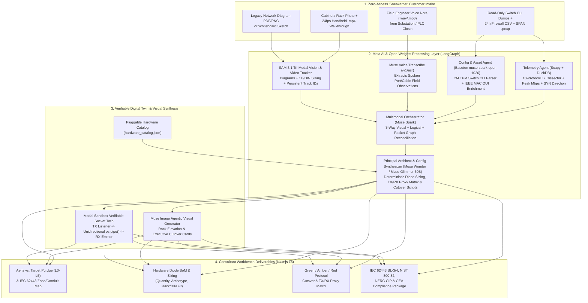
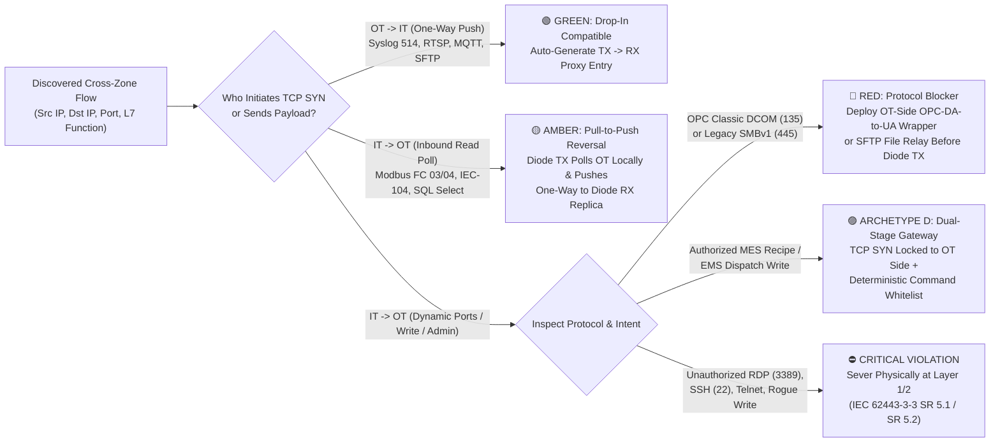

<div align="center">

# 🛡️ ConduitAI

### Autonomous OT Network Isolation, Hardware Data Diode Sizing & IEC 62443 Engineering Workbench

**Meta Global AI Developer Hackathon 2026** · **Problem Statement:** *Push the Frontier* · **Track:** *Indie Developer*

[](#meta-ai--open-weights-stack)
[](#meta-ai--open-weights-stack)
[](#meta-ai--open-weights-stack)
[](#meta-ai--open-weights-stack)
[](#meta-ai--open-weights-stack)
[](#built-with-meta-muse-code)
[-5B3DF5?style=for-the-badge)](#meta-ai--open-weights-stack)
[](#meta-ai--open-weights-stack)
[](#meta-ai--open-weights-stack)
[](#system-architecture)

</div>

---

## ⚡ 30-Second Overview

Power grids, water utilities, and manufacturing plants are prime targets for ransomware because 20-year-old Operational Technology (**OT**) control networks remain bridged to corporate **IT** through software firewalls that can be misconfigured, exploited via zero-day CVEs, or bypassed by dual-homed servers and rogue 5G modems.

**Hardware Data Diodes**—OS-less physical Layer-1/2 microchips and optical isolation gateways that enforce one-way data flow by the laws of physics—are the gold standard for critical infrastructure defense (**IEC 62443 SL-4**). Yet installing a data diode blindly breaks legacy plants because industrial historians, PLCs, and SCADA servers poll each other bi-directionally. Today, it takes senior OT security architects **2–3 weeks of manual consulting** to audit traffic, inspect physical cabinets, size hardware diodes, reverse polling protocols, and verify zero-downtime cutover.

**ConduitAI compresses 3 weeks of air-gap engineering into 60 seconds.** Operating out-of-band on offline "sneakernet" artifacts—network diagrams, smartphone cabinet photos & `.mp4` walkthrough videos, field-engineer voice notes, read-only switch CLI dumps, firewall CSVs, and SPAN `.pcap` captures—ConduitAI autonomously:
1. **Segments diagrams, cabinets & handheld rack videos (`Meta SAM 3.1`) + transcribes field-engineer audio notes (`Meta Muse Voice Transcribe`)** to detect intended zones, empty `1U` rack slots, `35mm` DIN-rail track width, spare RJ45/SFP ports, and physical rogue 5G bypass modems.
2. **Reconciles logical & packet reality (`Baseten meta-models/muse-spark-open-1026` + `DuckDB`)** to uncover undocumented shadow PLCs, dual-homed firewall bypasses, peak Mbps throughput, and deep Layer-7 Read vs. Write function codes across 10 OT protocols.
3. **Orchestrates multi-step discovery (`Meta Muse Spark`) & synthesizes hardware sizing + remediation configs (`Meta Muse Wonder` + `Meta Muse Image`)**—or runs in **Air-Gapped On-Prem Mode (`Meta Muse Glimmer` 30B)**—producing **Green / Amber / Red** cutover matrices, **TX/RX Proxy Translation Tables**, rack-mount elevation cards, and **IEC 62443 / NIST 800-82 / NERC CIP / CEA** compliance reports.
4. **Verifies cutover inside an isolated Layer-1/2 Socket Digital Twin (`Modal Sandboxes`)**, replaying legitimate telemetry across a real unidirectional `os.pipe()` diode barrier alongside simulated ransomware lateral movement to prove **0% operational downtime** and **100% physical inbound exploit drop**.

---

## 🏗️ System Architecture

### End-to-End Multi-Modal Verifiable Agent Pipeline



### Green / Amber / Red Hardware Diode Cutover Decision Logic



---

## 🧠 Meta AI & Open-Weights Stack

- **`Meta SAM 3.1` (Tri-Modal Industrial Vision & Video Tracking — `api.meta.ai/v1`):**
  - *Mode 1 (Multi-Style Topology Parser):* Segments security zones, swimlanes, and icons across Visio, One-Line CAD, aged blueprints, and smartphone whiteboard photos.
  - *Mode 2 (Physical Cabinet Sizer):* Measures empty `1U` slots, `35mm` DIN-rail track width in millimeters, spare `RJ45`/`SFP` ports, and rogue hardware.
  - *Mode 3 (24fps `.mp4` Video Walkthrough Tracker):* Maintains persistent `object_track_id`s across vertical camera pans so slots/ports are never double-counted and tracks blinking rogue 5G cellular bypass modems.
- **`Meta Muse Spark` (Multimodal Agentic Supervisor — `api.meta.ai/v1`):** Orchestrates parallel tool calls across vision crops, audio transcripts, switch configs, and packet SQL queries to reconcile the 3-way Purdue `L0–L5` graph.
- **`Meta Muse Wonder` (Frontier Architecture & Remediation Synthesizer — `api.meta.ai/v1`):** Performs deep cross-artifact reasoning for deterministic `1.25x` headroom diode sizing, `TX/RX` proxy translation tables, Cisco/Hirschmann VLAN/SPAN cutover scripts, and multi-standard regulatory citations.
- **`Meta Muse Image` (Agentic Hardware Elevation & Summary Cards — `api.meta.ai/v1`):** Generates annotated 19-inch rack / DIN-rail placement cards and executive architecture visuals for customer sign-off packages.
- **`Meta Muse Voice Transcribe` (Field-Engineer Audio Intake — `api.meta.ai/v1/asr`):** Transcribes spoken walkthrough observations from noisy substations and PLC closets, automatically correlating spoken port/cable callouts against `SAM 3.1` video tracks and switch ARP tables.
- **`Baseten` (`meta-models/muse-spark-open-1026` @ 2M TPM):** High-throughput open-weights inference parsing multi-thousand-line Cisco IOS, Rockwell Stratix, Hirschmann HiOS, and Moxa CLI dumps enriched with `oui_vendors.json`.
- **`Meta Muse Glimmer` (`Muse-Glimmer-30B` Apache 2.0 Open Weights on `Modal` Serverless GPU):** Powers ConduitAI's **1-Click Air-Gapped On-Prem Mode**, proving critical infrastructure operators (nuclear, 220kV grid, defense) can run the full reasoning pipeline without sending sensitive topology telemetry to public clouds.
- **`Modal Sandboxes` (Verifiable Layer-1/2 Socket Digital Twin):** Spins up isolated sandboxes (`scaledown_window=60` scale-to-zero) running a real `TX TCP Listener -> unidirectional os.pipe() -> RX TCP Emitter` pipeline to verify `0%` operational downtime and `100%` inbound exploit drop.

### Built with Meta Muse Code
**`Meta Muse Code`** accelerates development and powers runtime remediation synthesis across `state.py`, `telemetry_duckdb_agent.py`, `proxy_table_gen.py`, and `PurdueTopologyGraph.tsx`.

---

## 📜 Hackathon Provenance & Original Contributions (Oct 26 – Nov 4, 2026)

In full accordance with the **Meta Global AI Developer Hackathon Rules** (*Indie Developer Track*, MIT Open-Source License):
- **100% Built During the Hackathon Window (Oct 26 – Nov 4, 2026):** Every line of application code in [`backend/`](backend/) (FastAPI SSE API, LangGraph multi-agent state machine, Unified Meta/Baseten/Glimmer model router, 10-protocol `Scapy`+`DuckDB` packet dissector, `SAM 3.1` tri-modal diagram/rack/video agent, `Muse Voice` field-note transcriber, `Muse Spark` + `Muse Wonder` sizing/compliance engine, `Modal` socket-level unidirectional pipe Digital Twin, and `.drawio`/PDF/`.zip` generators) and [`frontend/`](frontend/) (Next.js 15 + React Flow interactive Purdue `L0–L5` workbench) was engineered from scratch during the official building period.
- **Public & Synthetic Evaluation Fixtures ([`data/`](data/) & [`docs/`](docs/)):** Real industrial hardware `.pcap` captures in [`data/real_ics_captures/`](data/real_ics_captures/) are sourced from public open-access repositories (**US CISA `cisagov`**, **UIUC ITI `CC-BY-4.0`**, and **Digital Bond**), paired with vendor-neutral sizing catalogs and synthetic 6-vertical digital twin test packs fully cited with SHA-256 checksums in [**`docs/DATA_SOURCES_AND_BENCHMARK_METHODOLOGY.md`**](docs/DATA_SOURCES_AND_BENCHMARK_METHODOLOGY.md).

---

## 🏭 6-Vertical Enterprise Benchmark, Real ICS Captures & SAM 3.1 Video Suite

| Scenario | Facility Profile | Key Protocols & Peak Bandwidth | Hidden Risks & Cutover Challenge | Expected Hardware Architecture |
| :--- | :--- | :--- | :--- | :--- |
| **1. Apex Automotive Stamping Plant** | Discrete manufacturing line (Siemens, Rockwell, Schneider) | `S7comm` (102), `Modbus TCP` (502), `OPC-DA DCOM` (135), `OPC-UA` (4840), `SMBv1` (445) — **85 Mbps** | Inbound Historian polling (`Amber`), DCOM dynamic ports (`Red`), rogue `Modbus FC 16` write, **3 undocumented Shadow PLCs** | `1x ARCH_C_ENTERPRISE_1U_DIODE` (in `SAM 3.1`-verified open 1U slot) + OPC-UA wrapper |
| **2. GridCore 220kV Power Substation** | HV transmission substation (SEL, ABB, GE Multilin IEDs) | `IEC 60870-5-104` (2404), `DNP3` (20000), `Modbus DGA`, `Syslog` — **42 Mbps** | Unauthorized inbound `IEC-104 TypeID 45` breaker trip command, SSH jump attempt, **2 commissioning Shadow Relays** | `1x ARCH_A_FIELD_DIODE` (NERC CIP-005-7 & India CEA / NCIIPC compliant) |
| **3. MetroCorp Smart Facility & CCTV** | Corporate tower with 48x 4K IP cameras & BMS HVAC | 48x `RTSP/RTP` streams (554), `BACnet/IP` (47808), `MQTT` (1883) — **420 Mbps sustained** | Compromised IP camera `172.16.40.33` scanning SMB/Modbus + **2 undocumented loading-dock cameras** | `1x ARCH_B_VIDEO_IOT_DIODE` (1 Gbps edge video/IoT proxy) |
| **4. AquaPure Water Treatment (SWaT)** | Municipal water & chlorine dosing facility (ControlLogix) | `EtherNet/IP CIP` (44818/2222), `Modbus TCP` (502), `VNC` (5900) — **65 Mbps** | **Stealth Rogue 5G Cellular Modem (`192.168.25.254`)** bypassing firewall to inject `Modbus FC 06` chlorine override | Sever rogue 5G physical link (spotted by `SAM 3.1`) + DIN-rail `ARCH_A` / `ARCH_B` |
| **5. PermianStream Oil & Gas Pipeline** | Remote midstream compressor station over Ku-Band VSAT | `DNP3` (20000), `Modbus RTU-TCP`, `SFTP` (22), `Telnet` (23), `SNMP` — **28 Mbps** | Cleartext `Telnet` root sessions to Lantronix serial terminal servers (`Red`) + **2 shadow metering skids** | `1x ARCH_A_FIELD_DIODE` + local SSH/serial migration |
| **6. BioVance Pharma Cleanroom GMP** | FDA 21 CFR Part 11 sterile biologics suite (ISO-5/ISO-7) | `OPC-UA` (4840), `MQTT` (1883), `SQL` (1433), **Signed PAS-X MES Recipes** (8443) — **190 Mbps** | Closed-loop signed batch recipe dispatch cannot traverse a pure one-way diode; **2 unvalidated GMP skids** | `1x ARCH_D_BIDIRECTIONAL_GATEWAY` (OT-initiated tandem hardware path) + `1x ARCH_C` |

---

## 🔌 Pluggable Vendor-Neutral Hardware Catalog

ConduitAI is **100% vendor-neutral** out of the box, sizing against four industry-standard **Hardware Isolation Archetypes** in [`data/catalogs/hardware_catalog.json`](data/catalogs/hardware_catalog.json):

| Archetype ID | Hardware Class | Max Throughput | Form Factor | Primary Protocols & Capacity |
| :--- | :--- | :--- | :--- | :--- |
| `ARCH_A_FIELD_DIODE` | Industrial Field Protocol Diode | `100 Mbps` | `DIN_RAIL` / `COMPACT_WALL` | Up to 32 PLCs (`MODBUS_TCP`, `IEC_104`, `DNP3`, `SYSLOG_UDP`) via local TX register poller $\rightarrow$ RX replica |
| `ARCH_B_VIDEO_IOT_DIODE` | Edge Video & IoT Unidirectional Proxy Diode | `1000 Mbps` | `1U_HALF_RACK` / `DIN_RAIL` | Up to 64x `1080p` or 24x `4K` `RTSP`/`ONVIF` streams, `MQTT`, `BACNET_TELEMETRY`, `HTTPS_PUSH` |
| `ARCH_C_ENTERPRISE_1U_DIODE` | 1U Enterprise Rackmount Protocol-Breaking Diode | `1000 Mbps` | `1U_19INCH_RACK` | Up to 16 `802.1Q` VLAN trunks; dual TX/RX TCP-terminating proxy CPUs (`OPC_UA`, `SQL_REPLICATION_PUSH`, `SFTP`, `MQTT`, `MODBUS_TCP`, `RTSP`) |
| `ARCH_D_BIDIRECTIONAL_GATEWAY` | Dual-Stage Controlled Bi-Directional Gateway | `1000 Mbps` Fwd / `100 Mbps` Rev | `1U_19INCH_RACK` | Tandem hardware isolation pathways; **TCP SYN locked strictly to OT side** + schema/command whitelisting for signed MES recipes & EMS dispatch |

---

## 🚀 Quickstart Setup

### Prerequisites
- **Python 3.12+** & [`uv`](https://docs.astral.sh/uv/)
- **Node.js 20+** & `npm`
- **Modal CLI** (`pip install modal && modal setup`)

### 1. Configure Environment Variables
```bash
cp .env.example .env
# Populate META_MODEL_API_KEY (https://api.meta.ai/v1) and BASETEN_API_KEY
```

### 2. Start the FastAPI + LangGraph + DuckDB Backend
```bash
cd backend
uv sync
uv run uvicorn app.main:app --reload --host 0.0.0.0 --port 8008
```

### 3. Launch the Next.js 15 Consultant Workbench
```bash
cd frontend
npm install
npm run dev
```

Open **[http://localhost:3000](http://localhost:3000)** and select any of the **6 Pre-Loaded Critical Infrastructure Scenarios**—or drag and drop your own network diagram, rack photo/video, field audio note, switch dump, and `.pcap` capture.

---

## 📄 License

Released under the [MIT License](LICENSE).
