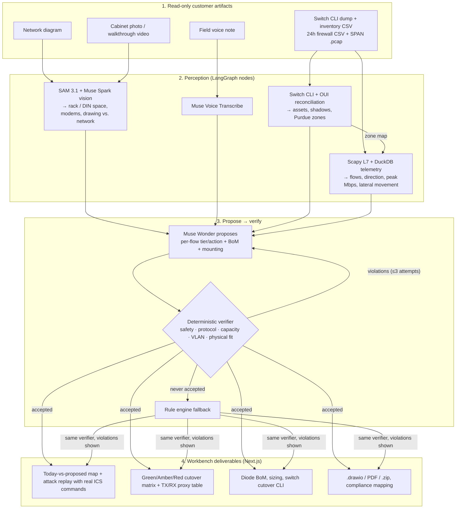
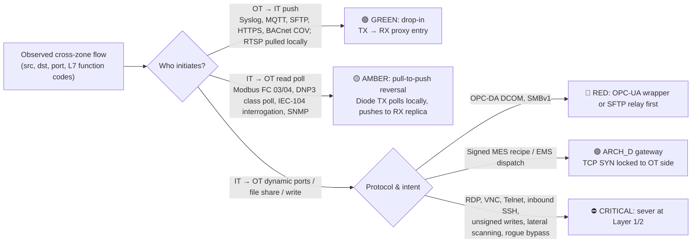

<div align="center">

# 🛡️ ConduitAI

### OT Network Isolation, Hardware Data Diode Sizing & IEC 62443 Cutover Workbench

**Meta Global AI Developer Hackathon 2026** · **Problem Statement:** *Push the Frontier* · **Track:** *Indie Developer*

[-0668E1?style=for-the-badge&logo=meta&logoColor=white)](#-how-the-meta-models-are-used)
[](#-how-the-meta-models-are-used)
[](#-how-the-meta-models-are-used)
[](#-how-the-meta-models-are-used)
[](#-system-architecture)

</div>

---

## ⚡ 30-Second Overview

Power grids, water utilities and factories are still bridged from their Operational Technology (**OT**) control networks to corporate **IT** through software firewalls. Those firewalls get misconfigured, exploited, or bypassed by dual-homed servers and rogue 5G modems.

**Hardware data diodes**, one-way optical or FPGA links, are the standard fix for critical infrastructure (**IEC 62443 SL-4**). But dropping a diode into a live plant breaks it: historians, SCADA servers and PLCs poll each other in both directions. Today a senior OT architect spends **weeks** auditing traffic, inspecting cabinets, sizing hardware and planning which flows can cross, which must be reversed, and which must be cut.

**ConduitAI turns the read-only artifacts a plant can hand over into a cutover plan:** SPAN `.pcap` captures, firewall CSVs, switch CLI dumps, asset inventories, cabinet photos and field notes. It produces:

1. **A measured flow inventory.** Scapy decodes Layer-7 function codes (Modbus read vs. write, IEC-104 breaker commands, DNP3 operate, S7comm, CIP, OPC-UA, BACnet), and DuckDB aggregates 24 h of FortiGate / PAN-OS logs. Zones come from the switch audit's Purdue levels, so direction (IT→OT vs. OT→IT) is computed rather than guessed. Lateral-movement scanning is flagged.
2. **Shadow-asset discovery.** Switch ARP/MAC tables are reconciled against the documented inventory, with OUI enrichment.
3. **An architecture designed by Meta Muse Wonder and checked by a deterministic verifier.** Muse Wonder proposes a Green / Amber / Red tier and an action for every flow, plus the diode bill of materials and mounting. The verifier rejects any unsafe or infeasible proposal and sends the violations back for revision. Unsafe means an inbound session graded GREEN, or remote admin or lateral movement left connected. Infeasible means a protocol the chosen diode can't proxy, under-capacity, too many VLANs, or no physical space.
4. **A today-vs-proposed map**, built from each run. Today every office↔plant connection passes the firewall in both directions, and bypass devices skip it entirely. With the plan every connection goes through the diode: plant data out, nothing in, and cut connections stop at the diode.
5. **Proof against a hacked IT network.** Real control commands taken from public ICS captures (IEC-104 breaker commands, DNP3 operate, Modbus writes) are replayed down the exact paths the plant's traffic uses. Substation: **39 of 39** reach plant equipment today, **0 of 39** with the plan. Water plant: **11 of 11** today, **0 of 11** with the plan. Real IEC-104 testbed: **56 of 56** today, **0 of 56** with the plan. The check can fail: a plan that leaves the water plant's cellular modem in place lets its commands through.
6. **A visible agent loop.** The workbench shows every draft the model wrote, the rule checker's verdict on each hard rule, and what was sent back for revision. A **Test the rule checker** button reopens the most dangerous connection the accepted plan cut and runs the real verifier on that change, so anyone can watch it get rejected.
7. **Sites it has never seen.** Six public ICS captures (Modbus, IEC-104, DNP3, C37.118, EtherNet/IP, IEC 61850) can be picked as sites and run from the packets alone: no asset list, drawing or photos.
8. **Engineer review and sign-off.** An engineer can change any connection's decision with a reason. The same verifier that checks the model re-checks the change, so reopening a command or bypass path is refused with the rules it breaks, and only an accepted change reaches the plan, the map and the downloads. Sign-off names the exact plan by its fingerprint, and any later change voids it.
9. **Questions for the site.** Where the supplied sources disagree, the workbench says so and asks. On the water plant the voice note says 250 mm of free DIN rail where SAM 3.1 measured 316 mm, and port Gi1/24 where the switch learned the modem on Fa1/24.
10. **Evidence and chain of custody.** Every input file is listed by SHA-256, every model with how it ran (live, recorded or rule engine), and every finding with the file it came from: packets from the capture, byte totals from the firewall log.
11. **Deliverables:** TX/RX proxy translation table, a switch cutover config built only from ports the switch dump shows (Cisco IOS or Hirschmann HiOS, with named placeholders where the dump is silent), `.drawio` topology, and a PDF report with the IEC 62443 / NIST 800-82 mapping, the site questions, the engineer review and the evidence manifest. The zip bundle carries the same review and manifest as JSON.

---

## 📊 Measured Results

Every number below is computed by [`backend/scripts/run_eval_benchmark.py`](backend/scripts/run_eval_benchmark.py). The script runs the real pipeline on each scenario's raw files and only then scores the plan against [`benchmark_ground_truth.json`](data/evals/benchmark_ground_truth.json). The pipeline never reads ground truth. Full output: [**`docs/BENCHMARK_SCORECARD.md`**](docs/BENCHMARK_SCORECARD.md).

| Metric | Rule engine only | **Muse Wonder + verifier** (cloud) | **Muse Spark Open + verifier** (open weights) |
| :--- | :--- | :--- | :--- |
| Hardware BoM exact (2 synthetic plants) | 1/2 | **2/2** | **2/2** |
| Flow tier correct (13 synthetic flows) | 13/13 | 13/13 | 13/13 |
| Attack traffic cut (7 critical flows, all 3 plants) | 7/7 | 7/7 | 7/7 |
| Real plant: labelled-normal control-centre session kept working | 1/1 | 1/1 | 1/1 |
| Unsafe passes (must-block flow graded GREEN) | 0 | 0 | 0 |
| Undocumented / rogue devices found (all 3 plants) | 9/9 | 9/9 | 9/9 |
| Architect time per plant | ~2 s | ~18–30 s | ~20–100 s |

*The model columns are one run each; model output varies between runs (in an earlier run Muse Spark Open sized 2 substation diodes where 1 suffices), so re-run `--live --open-weights` to reproduce.*

- **Real traffic, external answer key.** Plant 3 is a public IEC-104 testbed capture with a recorded attack, scored against the dataset authors' own labels. From the capture and an asset list alone, ConduitAI finds all 5 hosts missing from the documentation, including the 3 attack machines, and every plan cuts all of their command traffic.
- **Keep the data, drop the commands.** The testbed's control centre polls seven RTUs and also sends breaker commands. Because it is on the site's asset list as the IEC-104 master, the plan keeps its monitoring: the diode's plant side reads the RTUs itself and pushes the values out, and the control centre's commands stop because nothing can travel inward. An unlisted host sending commands is still cut. (An earlier version cut the whole session; the scorecard caught it.)
- **Where the model adds value:** the water plant mixes PLC polling with camera streams. The rule engine picks one video diode; both models pick a field diode for the PLCs plus a video diode for the cameras, which matches the answer key. The verifier, which also checks every rule-engine plan, flags the rule engine's kit: the video diode can't proxy the PLCs' Modbus TCP.
- **Open weights are enough.** Meta's open-weights **Muse Spark Open** (`muse-spark-open-1026`, served by Baseten) designs the same kits as Muse Wonder and passes the same verifier. That matters for this domain: a utility that won't send plant traffic to a cloud API can run the architect on its own hardware. The UI's **Air-Gapped** switch runs the architect, the drawing reads and the rack-gap checks on Muse Spark Open; SAM 3.1 has no open-weights endpoint here and stays on the cloud API.
- **The verifier catches the model.** On the three plants every draft in the scorecard run passed first time. On the six never-seen captures, 4 of 12 drafts were rejected and fixed on the second attempt. The telling one: Muse Spark Open relabelled the synchrophasor stream, which the data concentrator opens to the PMU, as plant-initiated so it could pass through unchanged. The verifier refused, because only a recognised push service may be reinterpreted that way. The other three were Muse Wonder drafts with an empty kit list. The story's *Our fix* step shows every draft, the checker's verdict on each hard rule, and a button that tries to sneak a dangerous change past the checker.
- **With 17 labelled flows, these scores are a demo sanity check, not a statistical claim.**

> Plants 1 and 2 are synthetic (see *What is synthetic* below) and were written alongside the parsers. Treat perception scores (assets, shadows, peak Mbps) as regression tests, not generalisation evidence. The parsers are also run against **15 real public ICS captures** (CISA and UIUC ITI, BSD-3-Clause / CC-BY-4.0): 12 yield Layer-7 decodes.

---

## 🔎 What Runs Live Today

| Stage | Status | Notes |
| :--- | :--- | :--- |
| Packet + firewall analysis (Scapy, DuckDB) | ✅ Real | Runs on any uploaded `.pcap` / FortiGate / PAN-OS CSV |
| Switch CLI + inventory reconciliation | ✅ Real (deterministic) | Cisco/Stratix, Hirschmann, Aruba, Moxa dumps + OUI table |
| Architect: Muse Wonder propose → verify | ✅ Live (`muse-wonder-1.0`) | 1–3 attempts, ~10–25 s at `ARCHITECT_REASONING_EFFORT=low`; falls back to the rule engine if no proposal is accepted. The fallback plan goes through the same verifier, and any violations are shown instead of hidden |
| Capture-only sites | ✅ Real | With no asset list, a host answering on an industrial port (Modbus 502, IEC-104 2404, DNP3 20000, S7/MMS 102, CIP 44818, C37.118 4712, OPC-UA 4840) is a plant device and a host that only polls devices is on the far side of the link. Nothing is called undocumented without a list to check against, and a master that sends commands is cut until an asset list vouches for it |
| Muse Voice Transcribe | ✅ Live for uploaded or recorded audio | Built-in scenarios use a sample transcript |
| SAM 3.1 cabinet measurement | ✅ Live (`sam-3.1` + `muse-spark-1.3`) | Empty rack units, free DIN-rail mm and rogue cellular modems are measured from SAM boxes, scaled by standard dimensions in the photo (see below). A gap between rack devices counts as free only after Muse Spark confirms its crop is empty. Responses are recorded under `data/cache/`, so offline runs replay real model output |
| SAM 3.1 on **real** photos | ⚠️ Fails safe, low coverage | On 17 real Wikimedia Commons photos: 2 of 11 enclosures measured, **0 false free-space claims**, 0 false modem alarms. Most real photos (angled, cluttered, doors in the way) come back "not measured". See [the real-photo check](docs/DATA_SOURCES_AND_BENCHMARK_METHODOLOGY.md#real-photo-check) |
| SAM 3.1 video tracking | ✅ Live, weak on the sample videos | 8 frames are sampled with PyAV, SAM runs on each and detections are linked into tracks. The two bundled walkthroughs are synthetic renders SAM barely recognises (detections in 2/8 and 5/8 frames), so they add little; real phone footage is needed |
| Network drawing vs. reality | ✅ Live (`sam-3.1` + `muse-spark-1.3`) | SAM finds every box on the customer's drawing and Muse Spark reads its name and IPs. The drawing is then compared with the hosts seen on the network: drawn devices never seen, and hosts on the network missing from the drawing (the water plant's cellular modem is one) |
| Muse Image rack card | ✅ Live endpoint | `POST /api/v1/visuals/rack-card` |
| Air-gapped mode: Muse Spark Open on Baseten | ✅ Live (`muse-spark-open-1026`) | Architect, drawing reads, rack-gap checks and the reconcile summary run on open weights; a self-hosted Muse Glimmer endpoint is used instead if `MUSE_GLIMMER_ENDPOINT_URL` is set |
| Socket "digital twin" | ⚠️ Mechanism demo | Real `os.pipe()` one-way relay, but it cannot fail by construction, so it is not counted as evidence of plan correctness |

The workbench shows this too. Model pills say *sim* when an integration has no credentials. Every screen is labelled as either reference data or a live pipeline result. The architect panel shows the actual proposal / verdict trace.

---

## 🏗️ System Architecture



### Green / Amber / Red Cutover Logic



---

## 🧠 How the Meta Models Are Used

- **`Muse Wonder` (`muse-wonder-1.0`, Meta Model API): the architect.** It receives an evidence pack: every measured flow with its L7 detail, peak and sized bandwidth, VLANs, shadow assets, and cabinet/video constraints. It returns strict JSON: per-flow initiator / tier / action / rationale, a bill of materials with mounting, and a target security level. [`architect_llm_planner.py`](backend/app/agents/architect_llm_planner.py) verifies the proposal against catalog-driven rules and returns violations to the model for revision. Reasoning effort is configurable (`ARCHITECT_REASONING_EFFORT`).
- **`SAM 3.1`: physical survey.** Each cabinet photo gets one concept prompt per call ("patch panel", "rack server", "electrical cabinet", "steel bar", "cellular modem", "antenna", …). [`sam_geometry.py`](backend/app/agents/sam_geometry.py) turns the boxes into measurements using standards visible in the same photo, with no per-site constants:
  - **Rack units:** a 19-inch panel is 482.6 mm wide and 1U is 44.45 mm, so the gaps between segmented rack gear are sized in U. A gap counts as empty only when Muse Spark, shown that crop, confirms nothing is mounted there. On a real rack it correctly rejected 16 U of "gaps" that were cable managers.
  - **DIN rail:** exposed rail is 35 mm tall, so each free segment's length is measured in mm.
  - **Rogue modems:** a cellular modem counts only when it sits inside a segmented enclosure. Whiteboards and sketches are recognised as non-cabinet photos and skipped.

  These measurements feed the architect's evidence pack and the verifier's physical-fit check, and the UI draws SAM's boxes in the photo's own pixel coordinates.
- **`Muse Spark` (`muse-spark-1.3`): reads what SAM finds.** It reads the name and IPs in each box SAM segments on the customer's network drawing, and confirms whether each rack gap is really empty. It is also the fallback for switch-dump enrichment.
- **`Muse Voice Transcribe`:** live transcription of uploaded or browser-recorded field notes into structured observations.
- **`Muse Image`:** rack / DIN-rail placement card generation.
- **`Muse Spark Open` (`muse-spark-open-1026`, open weights via Baseten): the air-gapped architect.** Same prompt, same verifier, same evidence as Muse Wonder; it also reads drawings and checks rack gaps in air-gapped mode. Point `MUSE_GLIMMER_ENDPOINT_URL` at a self-hosted Muse Glimmer server to keep everything on site.

---

## 🏭 Three Demo Plants

| Plant | Profile | Key protocols, peak | What the client sees |
| :--- | :--- | :--- | :--- |
| **1. GridCore 220 kV Substation** | SEL / ABB / GE IEDs in a control-room rack | IEC-104, DNP3, Modbus, Syslog, 42 Mbps | Today an IT host can send an IEC-104 breaker-trip command and open SSH sessions into the substation. A field diode in the measured free rack space cuts both, while telemetry keeps flowing out |
| **2. AquaPure Water Treatment** | Chlorine dosing, ControlLogix, DIN-rail cabinets | EtherNet/IP CIP, Modbus, VNC, 65 Mbps | A cellular modem in the cabinet bypasses the firewall entirely. A diode alone isn't enough: the modem must be removed, and the PLC and camera traffic need two diodes |
| **3. UOWM IEC-104 testbed (real traffic)** | Public university grid testbed: 7 RTUs, an HMI and 3 attack machines ([details](data/scenarios/scenario_5_uowm_iec104/README.md)) | IEC-104, 26,197 real packets over 4.2 h | Real traffic with a recorded attack. ConduitAI has to find the attackers from the capture and an asset list alone, and is scored against the dataset authors' own labels |

---

## 🔌 Vendor-Neutral Hardware Catalog

Sizing runs against four archetypes in [`data/catalogs/hardware_catalog.json`](data/catalogs/hardware_catalog.json). Point `HARDWARE_CATALOG_PATH` at a vendor catalog with the same schema to quote real SKUs.

| Archetype | Class | Sustained | Form factor | Proxied protocols |
| :--- | :--- | :--- | :--- | :--- |
| `ARCH_A_FIELD_DIODE` | Industrial field protocol diode | 80 Mbps | DIN rail / compact wall | Modbus TCP, DNP3, IEC-104, Syslog, SFTP, HTTPS push |
| `ARCH_B_VIDEO_IOT_DIODE` | Edge video & IoT diode | 800 Mbps | ½-1U / DIN rail | RTSP, ONVIF, MQTT, BACnet telemetry, Syslog, HTTPS push |
| `ARCH_C_ENTERPRISE_1U_DIODE` | 1U multi-VLAN protocol-breaking diode | 850 Mbps | 1U rack | OPC-UA, SQL replication, SFTP, MQTT, Modbus TCP, DNP3, RTSP, SMTP, HTTPS, Syslog |
| `ARCH_D_BIDIRECTIONAL_GATEWAY` | Dual-stage OT-locked gateway | 800 Mbps | 1U rack | Adds signed recipe / setpoint dispatch, with the TCP SYN locked to the OT side |

---

## 🚀 Quickstart

**Prerequisites:** Python 3.12+ with [`uv`](https://docs.astral.sh/uv/), Node.js 20+.

```bash
cp .env.example .env          # set META_MODEL_API_KEY for the live Muse Wonder architect
cd backend && uv sync
uv run uvicorn app.main:app --reload --host 0.0.0.0 --port 8008
```

```bash
cd frontend && npm install && npm run dev
```

Open **http://localhost:3000**. Pick one of the three demo plants and press **Run Analysis**. The default **Simple story** view walks through three plain-language steps (*What we found → Our fix → Proof*); **Engineer detail** shows every flow, rule, measurement and file. Alternatively, use **Upload** on each row of the Site Files checklist (traffic logs accept several files at once), then **Analyze Uploaded Files**.

**Host it without API keys:** the root `Dockerfile` runs the backend with recorded model output (SAM 3.1, Muse Spark, and the Muse Wonder / Muse Spark Open architect proposals, which the live verifier still checks). See [`docs/DEPLOY.md`](docs/DEPLOY.md).

**Reproduce the benchmark:**

```bash
cd backend
uv run python scripts/run_eval_benchmark.py          # rule engine, no API calls
uv run python scripts/run_eval_benchmark.py --live --open-weights   # + Muse Wonder and Muse Spark Open
uv run python scripts/check_real_photos.py           # SAM on real Commons photos
uv run pytest -q
```

---

## 📜 Provenance

- The git history starts on **2026-10-26**, the hackathon kickoff day (first commit 19:56 ET, after the noon kickoff). Application code in [`backend/`](backend/) and [`frontend/`](frontend/) was written during the event.
- The real industrial captures in [`data/real_ics_captures/`](data/real_ics_captures/) come from two public repositories: US CISA `cisagov` ICSNPP (BSD-3-Clause) and UIUC ITI `ICS-Security-Tools` (CC-BY-4.0). `data/scripts/verify_real_ics_captures.py` re-downloads each file and checks it matches. Sources and SHA-256 checksums are listed in [`docs/DATA_SOURCES_AND_BENCHMARK_METHODOLOGY.md`](docs/DATA_SOURCES_AND_BENCHMARK_METHODOLOGY.md).

### What is synthetic

No real customer site was used. Plants 1 and 2 are generated; plant 3 is real public traffic (see below):

| Artifact | How it was made |
| :--- | :--- |
| SPAN `.pcap` captures, firewall CSVs, switch CLI dumps, asset inventories | Generated by scripts in this repo, with protocol-valid packets and Layer-7 payloads |
| Cabinet and rack photos (`*.jpg` in `data/scenarios/`, `data/visuals/`) | AI-generated images, not photographs of real sites. SAM 3.1 measures them well; it does much worse on real photos, which is why the real-photo check exists |
| Network drawings (`*_diagram.png`) | Generated images |
| Walkthrough videos (`data/videos/*.mp4`) | Rendered by [`generate_rack_videos.py`](data/scripts/generate_rack_videos.py) |
| Field voice notes | Sample transcripts. Live transcription runs on audio you upload or record |
| Answer key (`benchmark_ground_truth.json`) | Plants 1 and 2: written by the author alongside the scenarios. Plant 3: taken from the public dataset's own attack labels and published topology |

**Plant 3 is real data:** IEC-104 traffic from the UOWM *IEC 60870-5-104 Intrusion Detection Dataset* (Zenodo 7108614, CC-BY-4.0, Radoglou-Grammatikis et al.), used without modification apart from merging the seven RTU-side captures. Attribution and modelling choices are in [its README](data/scenarios/scenario_5_uowm_iec104/README.md).

## 📄 License

Released under the [MIT License](LICENSE).
