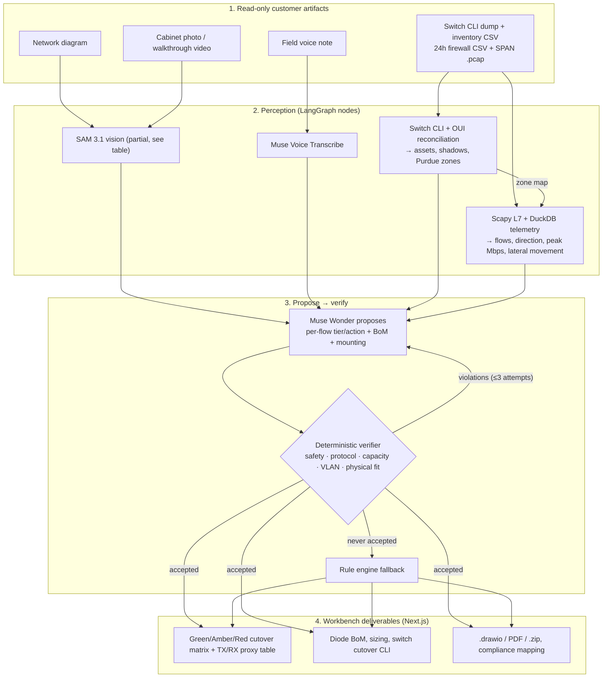
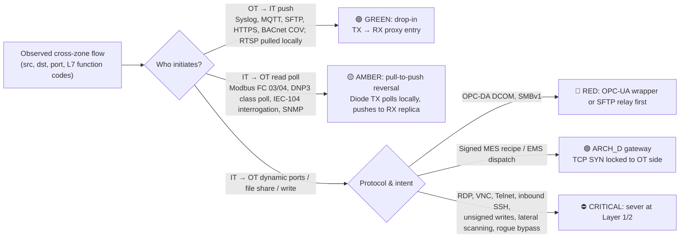

<div align="center">

# 🛡️ ConduitAI

### OT Network Isolation, Hardware Data Diode Sizing & IEC 62443 Cutover Workbench

**Meta Global AI Developer Hackathon 2026** · **Problem Statement:** *Push the Frontier* · **Track:** *Indie Developer*

[-0668E1?style=for-the-badge&logo=meta&logoColor=white)](#-how-the-meta-models-are-used)
[](#-how-the-meta-models-are-used)
[](#-how-the-meta-models-are-used)
[](#-how-the-meta-models-are-used)
[](#-system-architecture)

</div>

---

## ⚡ 30-Second Overview

Power grids, water utilities and factories are still bridged from their Operational Technology (**OT**) control networks to corporate **IT** through software firewalls. Those firewalls get misconfigured, exploited, or bypassed by dual-homed servers and rogue 5G modems.

**Hardware data diodes**, one-way optical or FPGA links, are the standard fix for critical infrastructure (**IEC 62443 SL-4**). But dropping a diode into a live plant breaks it: historians, SCADA servers and PLCs poll each other in both directions. Today a senior OT architect spends **weeks** auditing traffic, inspecting cabinets, sizing hardware and planning which flows can cross, which must be reversed, and which must be cut.

**ConduitAI turns the read-only artifacts a plant can hand over into a cutover plan:** SPAN `.pcap` captures, firewall CSVs, switch CLI dumps, asset inventories, cabinet photos and field notes. It produces:

1. **A measured flow inventory.** Scapy decodes Layer-7 function codes (Modbus read vs. write, IEC-104 breaker commands, DNP3 operate, S7comm, CIP, OPC-UA, BACnet), and DuckDB aggregates 24 h of FortiGate / PAN-OS logs. Zones come from the switch audit's Purdue levels, so direction (IT→OT vs. OT→IT) is computed rather than guessed. Lateral-movement scanning is flagged.
2. **Shadow-asset discovery.** Switch ARP/MAC tables are reconciled against the documented inventory, with OUI enrichment.
3. **An architecture designed by Meta Muse Wonder and checked by a deterministic verifier.** Muse Wonder proposes a Green / Amber / Red tier and an action for every flow, plus the diode bill of materials and mounting. The verifier rejects any unsafe or infeasible proposal and sends the violations back for revision. Unsafe means an inbound session graded GREEN, or remote admin or lateral movement left connected. Infeasible means a protocol the chosen diode can't proxy, under-capacity, too many VLANs, or no physical space.
4. **Deliverables:** TX/RX proxy translation table, switch cutover CLI, `.drawio` topology, PDF report and IEC 62443 / NIST 800-82 / NERC CIP mapping.

---

## 📊 Measured Results

Every number below is computed by [`backend/scripts/run_eval_benchmark.py`](backend/scripts/run_eval_benchmark.py). The script runs the real pipeline on each scenario's raw files and only then scores the plan against [`benchmark_ground_truth.json`](data/evals/benchmark_ground_truth.json). The pipeline never reads ground truth. Full output: [**`docs/BENCHMARK_SCORECARD.md`**](docs/BENCHMARK_SCORECARD.md).

| Metric (6 scenarios, 43 labelled flows) | Rule engine only | **Muse Wonder + verifier** |
| :--- | :--- | :--- |
| Hardware BoM exact (archetypes + quantity) | 5/6 | **6/6** |
| Flow Green/Amber/Red tier correct | 40/43 (93.0%) | 40/43 (93.0%) |
| Critical violations severed at L1 | 9/10 (90%) | 9/10 (90%) |
| Unsafe passes (must-block flow graded GREEN) | 0 | 0 |
| Shadow / rogue assets found | 13/13 | 13/13 |

*The live column is one run; Muse Wonder's output varies a little between runs, so re-run `--live` to reproduce.*

- **Where the model adds value:** design choices the rule engine can't make. It picks a field diode plus a video diode for the water plant's mixed PLC + camera traffic, and adds an enterprise diode beside the gateway in the pharma suite.
- **The verifier catches the model.** In the smart-building run, Muse Wonder first proposed relaying the compromised camera's SMB scan through an SFTP relay. The verifier rejected it (lateral movement must be severed), and the model revised the plan. The Compatibility tab shows each attempt and its violations.
- **The remaining 3 flow misses** are flows listed in the answer key that don't exist in the scenario's capture or logs (S3 syslog, S3 RDP), or are listed with IPs that don't match the traffic (S5 SMB). They are not counted as wins.

> The six scenarios are synthetic and were written alongside the parsers. Treat perception scores (assets, shadows, peak Mbps) as regression tests, not generalisation evidence. The parsers are also run against **15 real public ICS captures** (CISA, UIUC ITI, Digital Bond): 13 yield Layer-7 decodes.

---

## 🔎 What Runs Live Today

| Stage | Status | Notes |
| :--- | :--- | :--- |
| Packet + firewall analysis (Scapy, DuckDB) | ✅ Real | Runs on any uploaded `.pcap` / FortiGate / PAN-OS CSV |
| Switch CLI + inventory reconciliation | ✅ Real (deterministic) | Cisco/Stratix, Hirschmann, Aruba, Moxa dumps + OUI table |
| Architect: Muse Wonder propose → verify | ✅ Live (`muse-wonder-1.0`) | 1–3 attempts, ~10–25 s at `ARCHITECT_REASONING_EFFORT=low`; falls back to the rule engine if no proposal is accepted |
| Muse Voice Transcribe | ✅ Live for uploaded or recorded audio | Built-in scenarios use a sample transcript |
| SAM 3.1 diagram / cabinet segmentation | ⚠️ Partial | Live SAM boxes are drawn, but cabinet measurements (empty 1U slots, DIN-rail mm) and rogue-modem detection still come from per-scenario profiles chosen by filename |
| Video walkthrough tracking | ⚠️ Sample data | Built-in videos replay annotated track files; no live video model yet |
| Muse Image rack card | ✅ Live endpoint | `POST /api/v1/visuals/rack-card` |
| Baseten `muse-spark-open-1026` | ⏸ Not configured | Switch parsing is deterministic; enrichment falls back to Muse Spark |
| Air-gapped Muse Glimmer mode | ⏸ Not configured | Requires a Glimmer endpoint; the UI marks it as simulated otherwise |
| Socket "digital twin" | ⚠️ Mechanism demo | Real `os.pipe()` one-way relay, but it cannot fail by construction, so it is not counted as evidence of plan correctness |

The workbench shows this too. Model pills say *sim* when an integration has no credentials. Every screen is labelled as either reference data or a live pipeline result. The architect panel shows the actual proposal / verdict trace.

---

## 🏗️ System Architecture



### Green / Amber / Red Cutover Logic



---

## 🧠 How the Meta Models Are Used

- **`Muse Wonder` (`muse-wonder-1.0`, Meta Model API): the architect.** It receives an evidence pack: every measured flow with its L7 detail, peak and sized bandwidth, VLANs, shadow assets, and cabinet/video constraints. It returns strict JSON: per-flow initiator / tier / action / rationale, a bill of materials with mounting, and a target security level. [`architect_llm_planner.py`](backend/app/agents/architect_llm_planner.py) verifies the proposal against catalog-driven rules and returns violations to the model for revision. Reasoning effort is configurable (`ARCHITECT_REASONING_EFFORT`).
- **`SAM 3.1`:** text-prompted segmentation of diagrams and cabinet photos via `/v1/responses`. Today the live boxes are overlaid on the image; turning them into measurements (free 1U slots, DIN-rail width) is the next step. See *What Runs Live Today*.
- **`Muse Spark` (`muse-spark-1.3`):** multimodal diagram extraction when SAM returns no boxes, and the fallback for switch-dump enrichment.
- **`Muse Voice Transcribe`:** live transcription of uploaded or browser-recorded field notes into structured observations.
- **`Muse Image`:** rack / DIN-rail placement card generation.
- **Air-gapped mode (`Muse Glimmer`) and Baseten** are wired in the model router but need their own endpoints / keys to run.

---

## 🏭 Six Benchmark Scenarios

| Scenario | Profile | Key protocols, peak | Cutover challenge |
| :--- | :--- | :--- | :--- |
| **1. Apex Automotive Stamping** | Siemens / Rockwell / Schneider line | S7comm, Modbus, OPC-DA DCOM, OPC-UA, SMBv1, 85 Mbps | Historian polling, DCOM dynamic ports, rogue Modbus FC 16 write, 3 shadow PLCs |
| **2. GridCore 220 kV Substation** | SEL / ABB / GE IEDs | IEC-104, DNP3, Modbus, Syslog, 42 Mbps | Inbound IEC-104 TypeID 45 breaker trip, inbound SSH, 2 shadow relays |
| **3. MetroCorp Smart Building** | 48 IP cameras + BMS | RTSP, BACnet/IP, MQTT, 420 Mbps | Compromised camera `172.16.40.33` scanning SMB / Modbus / SSH |
| **4. AquaPure Water Treatment** | Chlorine dosing, ControlLogix | EtherNet/IP CIP, Modbus, VNC, 65 Mbps | Rogue 5G modem bypass injecting Modbus FC 06 |
| **5. PermianStream Pipeline** | Remote compressor station over VSAT | DNP3, Modbus, SFTP, Telnet, SNMP, 28 Mbps | Cleartext Telnet to serial servers, SMB share into OT |
| **6. BioVance Pharma Cleanroom** | GMP biologics suite | OPC-UA, MQTT, SQL, signed MES recipes, 190 Mbps | Signed recipe dispatch can't cross a pure one-way diode |

---

## 🔌 Vendor-Neutral Hardware Catalog

Sizing runs against four archetypes in [`data/catalogs/hardware_catalog.json`](data/catalogs/hardware_catalog.json). Point `HARDWARE_CATALOG_PATH` at a vendor catalog with the same schema to quote real SKUs.

| Archetype | Class | Sustained | Form factor | Proxied protocols |
| :--- | :--- | :--- | :--- | :--- |
| `ARCH_A_FIELD_DIODE` | Industrial field protocol diode | 80 Mbps | DIN rail / compact wall | Modbus TCP, DNP3, IEC-104, Syslog, SFTP, HTTPS push |
| `ARCH_B_VIDEO_IOT_DIODE` | Edge video & IoT diode | 800 Mbps | ½-1U / DIN rail | RTSP, ONVIF, MQTT, BACnet telemetry, Syslog, HTTPS push |
| `ARCH_C_ENTERPRISE_1U_DIODE` | 1U multi-VLAN protocol-breaking diode | 850 Mbps | 1U rack | OPC-UA, SQL replication, SFTP, MQTT, Modbus TCP, DNP3, RTSP, SMTP, HTTPS, Syslog |
| `ARCH_D_BIDIRECTIONAL_GATEWAY` | Dual-stage OT-locked gateway | 800 Mbps | 1U rack | Adds signed recipe / setpoint dispatch, with the TCP SYN locked to the OT side |

---

## 🚀 Quickstart

**Prerequisites:** Python 3.12+ with [`uv`](https://docs.astral.sh/uv/), Node.js 20+.

```bash
cp .env.example .env          # set META_MODEL_API_KEY for the live Muse Wonder architect
cd backend && uv sync
uv run uvicorn app.main:app --reload --host 0.0.0.0 --port 8008
```

```bash
cd frontend && npm install && npm run dev
```

Open **http://localhost:3000**. Pick one of the six sample sites and press **Run Analysis**. Alternatively, use **Upload** on each row of the Site Files checklist (traffic logs accept several files at once), then **Analyze Uploaded Files**.

**Reproduce the benchmark:**

```bash
cd backend
uv run python scripts/run_eval_benchmark.py          # rule engine, no API calls
uv run python scripts/run_eval_benchmark.py --live   # + Muse Wonder / verifier
uv run pytest -q
```

---

## 📜 Provenance

- The git history starts on **2026-10-26**, the first day of the hackathon build window. Application code in [`backend/`](backend/) and [`frontend/`](frontend/) was written during the event.
- The real industrial captures in [`data/real_ics_captures/`](data/real_ics_captures/) come from public repositories: US CISA `cisagov`, UIUC ITI (CC-BY-4.0) and Digital Bond. The six vertical scenarios are synthetic. Sources and SHA-256 checksums are listed in [`docs/DATA_SOURCES_AND_BENCHMARK_METHODOLOGY.md`](docs/DATA_SOURCES_AND_BENCHMARK_METHODOLOGY.md).

## 📄 License

Released under the [MIT License](LICENSE).
