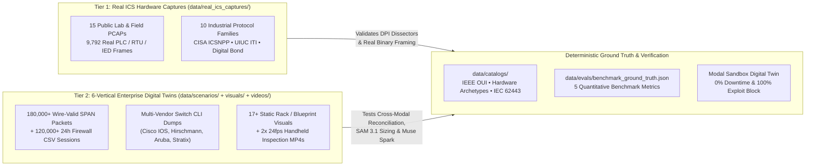

# 📊 ConduitAI — Data Sources, Hybrid OT Dataset Provenance & Benchmark Methodology

> **Current scope (2026-10-28):** the demo and benchmark now use **two plants**: the GridCore substation (`scenario_2_substation`) and the AquaPure water-treatment plant (`scenario_4_water_treatment`). The other four scenarios described below were removed from the app and benchmark and remain only in git history.
>
> **Synthetic media:** the cabinet and rack photos are AI-generated images, and the walkthrough videos are rendered by `generate_rack_videos.py`. None of them was photographed or filmed at a real site. The real data in this repo is the 15 public ICS captures in `data/real_ics_captures/`. Measured results are in [`BENCHMARK_SCORECARD.md`](BENCHMARK_SCORECARD.md).

> **Hackathon Submission Reference & Judge Q&A Companion**
> Designed so engineering, compliance, and evaluation sections can be cited or copied directly into the **Meta Global AI Developer Hackathon** submission writeup, architecture pitch deck, and live technical Q&A.

---

## 1. Overview — Why OT Cybersecurity Requires a Hybrid Real + High-Scale Digital Twin Dataset

Operational Technology (**OT**) and Industrial Control System (**ICS / SCADA**) networks govern physical equipment where cyber intrusions carry kinetic consequences: tripping 220kV power transmission breakers, altering municipal drinking-water chemical dosing, or halting sterile pharmaceutical biologics lines. Because of this national-security sensitivity, **real production boundary captures from operating Critical Information Infrastructure (CII) cannot legally be published in the public domain**:

| Regulatory Regime | Jurisdiction & Sector | Legal Disclosure Restriction on Live OT Topologies & PCAPs |
| :--- | :--- | :--- |
| **NERC CIP-011-3** (*Information Protection*) | North American Bulk Electric System (**BES**) | Classifies substation routable IP subnets, Electronic Access Point (**EAP**) firewall rulebases, switch configs, and physical cabinet layouts as **BES Cyber System Information (BCSI)**—prohibiting public release. |
| **DHS PCII Program** (*6 CFR Part 29 / CII Act*) | U.S. 16 Critical Infrastructure Sectors | Protects physical/logical plant architecture diagrams, vulnerability audits, and perimeter traffic logs as **Protected Critical Infrastructure Information (PCII)** exempt from FOIA and public distribution. |
| **India CEA Guidelines (2021) & NCIIPC Directives** | Indian Power Grid (220kV–765kV, SLDC/RLDC) & National CII (*IT Act Sec. 70/70A*) | Restricts external export of Substation Automation System (**SAS**) network captures, IED addressing, and Electronic Security Perimeter topologies from Protected Systems. |
| **TSA Pipeline Directives & FDA 21 CFR Part 11** | Midstream Oil & Gas Pipelines / GMP Biologics | Prohibits public disclosure of Safety Instrumented System (**SIS**) addressing, compressor SCADA telemetry, and proprietary Electronic Batch Record (**EBR**) payloads. |

Consequently, academic and open-source ICS captures are invaluable for **authentic wire-level PLC/RTU frame structure**, yet are typically isolated single-protocol bench traces (`100–3,000` packets) lacking simultaneous 24-hour perimeter firewall CSV logs, multi-switch Cisco/Hirschmann CLI ARP/MAC dumps, legacy CAD/whiteboard diagrams, and smartphone cabinet video needed to benchmark an **end-to-end multi-modal air-gap engineering system**.

### ConduitAI's Two-Tier Hybrid Dataset Architecture

To achieve **100% wire-level industrial authenticity** *and* **enterprise plant-scale multi-modal complexity** without violating CII disclosure laws, ConduitAI combines two complementary layers:

> [!TIP]
> **Ready-to-Use Judge Q&A Answer — *"Is ConduitAI tested on real industrial traffic or synthetic data?"***
> *"Both. Live power utilities and water plants are legally barred from publishing full boundary captures under NERC CIP-011 BCSI, DHS PCII, and India CEA/NCIIPC directives. We therefore validate our Scapy + DuckDB deep packet dissectors against **15 real hardware ICS packet captures (`9,792` packets across `10` protocols)** sourced from **U.S. CISA (`icsnpp`)**, **UIUC Information Trust Institute**, and **Digital Bond Quickdraw**—covering physical Siemens S7-1500/400, Rockwell ControlLogix 5000, Schneider Modicon, DNP3/IEC-104 relays, and IEEE C37.118 synchrophasors. On top of those verified wire dissectors, we benchmark full cross-modal reasoning (`Meta SAM 3.1` + `Muse Spark` + `Baseten` + `Modal`) across a **6-vertical critical infrastructure digital twin suite (`180,000+` RFC-compliant packets, `120,000+` firewall sessions, 17+ physical rack/diagram visuals, and `24 fps` handheld rack-inspection videos)** with exact mathematical ground truth."*

---

## 2. Real-World Public ICS Hardware Captures (`data/real_ics_captures/`)

ConduitAI ships with **15 cryptographically verified, publicly licensed OT hardware packet captures** (`1.16 MB`, `9,792` frames, zero Git LFS dependencies) harvested and validated via [`data/scripts/download_real_ics_pcaps.py`](../data/scripts/download_real_ics_pcaps.py) and indexed in [`data/real_ics_captures/REAL_PCAP_MANIFEST.json`](../data/real_ics_captures/REAL_PCAP_MANIFEST.json).

### Upstream Industrial Cybersecurity Repositories & Reference Testbeds

1. **U.S. Cybersecurity and Infrastructure Security Agency (`cisagov/icsnpp-*`)** — Official CISA Industrial Control Systems Network Protocol Parsers project (`BSD-3-Clause`), providing field-grade traces for **Siemens S7comm-plus**, **DNP3**, **EtherNet/IP CIP**, **BACnet/IP**, and **OPC-UA Binary**.
2. **UIUC Information Trust Institute (`ITI/ICS-Security-Tools`)** — University of Illinois Urbana-Champaign SCADA security research corpus (`CC-BY-4.0`), providing production **Siemens S7-400 + WinCC**, **Schneider Modicon**, **IEC 60870-5-104**, **IEC 61850 MMS & GOOSE**, and **IEEE C37.118 PMU** traces.
3. **ICS-pcap & Digital Bond Quickdraw SCADA Archive (`automayt/ICS-pcap`)** — Public community ICS capture repository incorporating Dale Peterson's **Digital Bond Quickdraw** PLC/outstation traces, **4SICS GeekLounge** conference lab captures, and **Wireshark ICS SampleCaptures** references (`Modbus TCP`, `ControlLogix 5000`, `S7-1200 TIA Portal`, `DNP3`, `IEC-104`).
4. **SUTD iTrust `SWaT` (Secure Water Treatment) Physical Testbed Architecture** — Structural reference from Singapore University of Technology and Design's 6-stage municipal water purification testbed (Purdue `L0–L3` PLC/HMI/Historian zoning and `EtherNet/IP` + `Modbus TCP` polling cadences) grounding Scenario 4.

### Complete Inventory of Real Hardware Captures

| # | Capture Filename | Protocol Family | Port / EtherType | Packets | Real Physical Hardware & Operational Context | Upstream Source & License |
| --: | :--- | :--- | :--- | --: | :--- | :--- |
| 1 | [`modbus_schneider_modicon_plc.pcap`](../data/real_ics_captures/modbus_schneider_modicon_plc.pcap) | **Modbus TCP** | `TCP/502` | 191 | Physical **Schneider Electric Modicon** PLC MBAP holding-register reads (`FC 03`), writes, and `FC 43` MEI device identification | `ITI/ICS-Security-Tools` (`CC-BY-4.0`) |
| 2 | [`modbus_digitalbond_quickdraw_plc.pcap`](../data/real_ics_captures/modbus_digitalbond_quickdraw_plc.pcap) | **Modbus TCP** | `TCP/502` | 350 | **Digital Bond Quickdraw** SCADA master polling coils/registers (`FC 01–04`) interleaved with actuation writes (`FC 05/06/15/16`) | `automayt/ICS-pcap` (Digital Bond Archive) |
| 3 | [`s7comm_siemens_s7_1200_tia_ob1.pcap`](../data/real_ics_captures/s7comm_siemens_s7_1200_tia_ob1.pcap) | **Siemens S7comm-plus** | `TCP/102` | 149 | **Siemens SIMATIC S7-1200** PLC & TIA Portal V12 engineering workstation uploading Organization Block `OB1` (`0x72`) | `automayt/ICS-pcap` (Community Archive) |
| 4 | [`s7comm_siemens_s7_400_wincc_prod.pcapng`](../data/real_ics_captures/s7comm_siemens_s7_400_wincc_prod.pcapng) | **Siemens S7comm** | `TCP/102` | 1,658 | Production **Siemens SIMATIC S7-400** PLC continuously polled by a **Siemens WinCC** SCADA HMI over RFC 1006 ISO-on-TCP (`0x32`) | `ITI/ICS-Security-Tools` (`CC-BY-4.0`) |
| 5 | [`s7comm_plus_siemens_s7_1500_cisa.pcap`](../data/real_ics_captures/s7comm_plus_siemens_s7_1500_cisa.pcap) | **Siemens S7comm-plus** | `TCP/102` | 262 | **Siemens SIMATIC S7-1500** Object Messaging System (`0x72` OMS) session captured on Linux cooked socket (`LINKTYPE_LINUX_SLL`) | `cisagov/icsnpp-s7comm` (`BSD-3-Clause`) |
| 6 | [`iec104_substation_rtu_diverse.pcap`](../data/real_ics_captures/iec104_substation_rtu_diverse.pcap) | **IEC 60870-5-104** | `TCP/2404` | 173 | Transmission substation RTU telecontrol trace with `STARTDT` / `TESTFR` U-frames, S-frames, and measured float ASDUs (`0x68`) | `ITI/ICS-Security-Tools` (`CC-BY-4.0`) |
| 7 | [`iec104_substation_rtu_polling.pcap`](../data/real_ics_captures/iec104_substation_rtu_polling.pcap) | **IEC 60870-5-104** | `TCP/2404` | 105 | Control-center SCADA master `C_IC_NA_1` General Interrogation and spontaneous substation RTU point reporting | `automayt/ICS-pcap` (Community Archive) |
| 8 | [`dnp3_substation_relay_cisa.pcap`](../data/real_ics_captures/dnp3_substation_relay_cisa.pcap) | **DNP3** | `TCP/20000` | 834 | Utility substation relay Class `0/1/2/3` integrity polls, Unsolicited Responses, and **Direct Operate** breaker commands (`0x0564`) | `cisagov/icsnpp-dnp3` (`BSD-3-Clause`) |
| 9 | [`dnp3_digitalbond_quickdraw_outstation.pcap`](../data/real_ics_captures/dnp3_digitalbond_quickdraw_outstation.pcap) | **DNP3** | `TCP/20000` | 181 | **Digital Bond Quickdraw** DNP3 master-to-outstation read/write and integrity interrogation trace | `automayt/ICS-pcap` (Digital Bond Archive) |
| 10 | [`enip_controllogix5000_mode_change.pcap`](../data/real_ics_captures/enip_controllogix5000_mode_change.pcap) | **EtherNet/IP (CIP)** | `TCP/44818` | 727 | **Rockwell Allen-Bradley ControlLogix 5000** PLC remote CPU keyswitch/mode change issued via RSLogix 5000 CIP | `automayt/ICS-pcap` (Digital Bond Archive) |
| 11 | [`enip_cip_explicit_and_implicit_io_cisa.pcap`](../data/real_ics_captures/enip_cip_explicit_and_implicit_io_cisa.pcap) | **EtherNet/IP (CIP)** | `TCP/44818`, `UDP/2222` | 776 | ODVA / Rockwell explicit CIP messaging (`TCP/44818`) paired with Class 1 cyclic implicit real-time I/O (`UDP/2222`) and LLDP | `cisagov/icsnpp-enip` (`BSD-3-Clause`) |
| 12 | [`bacnet_ip_building_controllers_cisa.pcap`](../data/real_ics_captures/bacnet_ip_building_controllers_cisa.pcap) | **BACnet/IP** | `UDP/47808` | 3,257 | Smart-building BMS network of **40+ BACnet/IP HVAC controllers** exchanging BVLC `0x81` `Who-Is`, `I-Am`, `ReadPropertyMultiple`, and `COV` | `cisagov/icsnpp-bacnet` (`BSD-3-Clause`) |
| 13 | [`opcua_binary_session_handshake_cisa.pcap`](../data/real_ics_captures/opcua_binary_session_handshake_cisa.pcap) | **OPC-UA Binary** | `TCP/4840` | 411 | OPC Unified Architecture binary transport handshake (`HEL`/`ACK`, `OpenSecureChannel`, `CreateSession`, `Read`, `Browse`) | `cisagov/icsnpp-opcua-binary` (`BSD-3-Clause`) |
| 14 | [`iec61850_substation_mms_and_goose.pcap`](../data/real_ics_captures/iec61850_substation_mms_and_goose.pcap) | **IEC 61850 MMS + GOOSE** | `TCP/102`, `0x88b8` | 301 | Digital substation protection IED capture combining Layer-7 **MMS** (`TCP/102`) with Layer-2 sub-4ms multicast **GOOSE** (`0x88b8`) | `ITI/ICS-Security-Tools` (`CC-BY-4.0`) |
| 15 | [`ieee_c37_118_synchrophasor_pmu.pcap`](../data/real_ics_captures/ieee_c37_118_synchrophasor_pmu.pcap) | **IEEE C37.118 PMU** | `TCP/4712` | 417 | High-voltage grid Phasor Measurement Unit (**PMU**) streaming `0xAA` real-time frequency/phasor telemetry to a Phasor Data Concentrator | `ITI/ICS-Security-Tools` (`CC-BY-4.0`) |

---

## 3. The 6-Vertical Enterprise Benchmark Suite (`180,000+` Packets & `120,000+` Firewall Sessions)

To evaluate ConduitAI across every hardware isolation archetype (`ARCH_A`, `ARCH_B`, `ARCH_C`, `ARCH_D`), physical enclosure constraint (`1U_19INCH_RACK` vs. `DIN_RAIL` vs. zero-space closet), and regulatory regime, our synthetic plant engine generates **six full-scale DHS/CISA Critical Infrastructure "Sneakernet Intake Packs"** totaling **`180,000+` wire-valid binary `libpcap` frames** (valid RFC 791 IPv4 checksums, RFC 793 TCP SYN/SYN-ACK/ACK state machines, and industrial Layer-7 binary payloads) alongside **`120,000+` 24-hour perimeter firewall CSV session records** and multi-vendor switch CLI dumps.

### 6-Vertical Critical Infrastructure Scenario Matrix

| # | Scenario ID & CISA Sector | Facility Profile & Switch CLI Vendor | Primary Protocols & Peak Bandwidth | Cross-Zone GAR Flow Breakdown (`Green` / `Amber` / `Red`) | Injected Shadow Assets & Security Violations | Ground-Truth Hardware Diode Sizing Trigger |
| --: | :--- | :--- | :--- | :--- | :--- | :--- |
| **1** | **`scenario_1_manufacturing`** *Apex Automotive Stamping Plant* (Critical Manufacturing) | 3-VLAN discrete stamping line (`Siemens S7-1500`, `Rockwell ControlLogix`, `Schneider Modicon`) + 19" control-room rack (`Cisco Catalyst IOS`) | `Modbus TCP` (502), `S7comm` (102), `OPC Classic DCOM` (135 + dynamic `49152–65535`), `SMBv1` (445), `MS-TDS SQL` (1433), `UDP Syslog` (514) — **85 Mbps peak** (`106.25 Mbps` w/ `1.25x` margin) | **🟢 Green:** Outbound `Syslog` (514), `OPC-UA` push **🟡 Amber:** Inbound IT Historian `Modbus FC 03` & `SQL SELECT` **🔴 Red:** `OPC-DA DCOM` (135), `SMBv1` (445), rogue IT `Modbus FC 16` register write, `RDP` (3389) | **2x Undocumented Shadow PLCs** (`.15`, `.16`) in ARP/PCAP absent from CAD diagram + **Dual-Homed Engineering Server** bridging OT VLAN 10 & IT VLAN 50 | **`1x ARCH_C_ENTERPRISE_1U_DIODE`** Exceeds `ARCH_A` `100 Mbps` & `2-VLAN` cap (`106.25 Mbps` w/ `1.25x` headroom across 3 `802.1Q` VLANs); fits `SAM 3.1`-verified open `1U` slot (`RU-14`) + local `OPC-DA-to-UA` wrapper & `SFTP` relay. |
| **2** | **`scenario_2_substation`** *GridCore 220kV Power Substation* (Energy / Bulk Electric System) | High-voltage transmission switchyard (`SEL-3530 RTAC`, `ABB Relion 670`, `GE Multilin` IEDs) + field marshalling cabinet (`Hirschmann HiOS`) | `IEC 60870-5-104` (2404), `DNP3` (20000), `IEC 61850 MMS/GOOSE`, `Modbus TCP` (502), `UDP Syslog` (514) — **18 Mbps peak** (`22.5 Mbps` w/ `1.25x` margin) | **🟢 Green:** Spontaneous `Syslog` & PMU/SOE export **🟡 Amber:** Regional SLDC/EMS inbound `IEC-104 C_IC_NA_1` & `DNP3 Class 0` polls **🔴 Red:** Unauthorized `RDP` (3389) & legacy `Telnet` (23) | **1x Shadow Bay Protection Relay** on Station Bus + unauthorized Interactive Remote Access violating **NERC CIP-005-7 R2** & **CEA Art. 10** | **`1x ARCH_A_FIELD_DIODE`** (`DIN_RAIL`) `SAM 3.1` detects **zero 19" rack space** (`185–250 mm` free `35mm` DIN rail, `< 100 Mbps`, `≤ 2 VLANs`). *(Evaluates `ARCH_D` only if closed-loop EMS AGC `C_SE_NA_1` dispatch is active).* |
| **3** | **`scenario_3_smart_building`** *MetroCorp Smart Campus & 48x CCTV* (Commercial Facilities) | Corporate headquarters security & BMS plant (`48x ONVIF 1080p PoE IP Cameras`, `BACnet/IP` HVAC chillers, `Aruba AOS-CX` switch) | 48x `RTSP/RTP` H.264 streams (554), `ONVIF` (80/8000), `BACnet/IP` (47808), `MQTT` (1883), `Syslog` (514) — **420 Mbps sustained** (`525 Mbps` w/ `1.25x` margin) | **🟢 Green:** `RTSP` camera streams, `BACnet COV`, `MQTT` telemetry **🟡 Amber:** Corporate VMS inbound camera profile queries **🔴 Red:** Direct IT `SSH` (22) & `HTTP` admin into vulnerable camera firmware | **4x Uninventoried Rogue PoE Cameras** (`Hikvision/Dahua` OUIs) + flat VLAN routing exposing corporate AD to camera-pivot lateral movement | **`1x ARCH_B_VIDEO_IOT_DIODE`** `525 Mbps` sized throughput exceeds `ARCH_A` (`100 Mbps`) ceiling; `48` streams fit within `ARCH_B`'s `64x 1080p RTSP` hardware media splicer capacity (`1 Gbps`). |
| **4** | **`scenario_4_water_treatment`** *AquaPure Municipal Water (SWaT)* (Water & Wastewater Systems) | 6-stage UF/RO/Chlorination municipal water plant modeled on SUTD `SWaT` (`Rockwell CompactLogix`, `WAGO PFC200`, `Stratix` IOS switch) | `EtherNet/IP CIP` (44818), `Modbus TCP` (502), `OPC-UA` (4840), `UDP Syslog` (514) — **34 Mbps peak** (`42.5 Mbps` w/ `1.25x` margin) | **🟢 Green:** `Syslog` & Historian push **🟡 Amber:** City SCADA inbound `Modbus FC 03/04` & `OPC-UA` read subscriptions **🔴 Red:** Contractor **TeamViewer / 5G cellular bypass** (`TCP 5938`) + inbound chemical NaOCl dosing write (`FC 06`) | **Rogue Cellular / Remote-Access Bridge** plugged into chemical dosing skid switch (Oldsmar-class attack vector) + undocumented dosing analyzer | **`1x ARCH_A_FIELD_DIODE`** (`DIN_RAIL`) Mounts directly on skid `35mm` DIN rail (`65mm` width); physically blocks inbound NaOCl chemical setpoint tampering (`SL-4`) while mirroring telemetry to municipal SCADA. |
| **5** | **`scenario_5_oil_gas_pipeline`** *PetroLink Compressor & Pipeline* (Energy — Oil & Gas Pipeline) | Midstream gas compressor station (`Honeywell Experion C300`, `Yokogawa ProSafe-RS SIS`, `Emerson ROC800` flow RTUs, `Cisco IOS-XE`) | `DNP3` (20000), `Modbus TCP` (502), `OPC-UA` (4840), `OPC-DA` (135), `SMBv1` custody tickets (445), **Signed Pipeline Dispatch Setpoints** — **62 Mbps Fwd / 4 Mbps Rev** | **🟢 Green:** `HTTPS Push`, `Syslog`, `SFTP` custody logs **🟡 Amber:** Inbound `DNP3` custody polls + **Authorized Closed-Loop Compressor Pressure Setpoint Dispatch** **🔴 Red:** `SMBv1` (445), `OPC-DA` (135), IT-to-SIS `Modbus` probe | **Improperly Bridged Safety Instrumented System (`ProSafe-RS SIS`)** reachable from L3 SCADA VLAN (violates `IEC 62443-3-3 SR 5.1 RE 3`) | **`1x ARCH_D_BIDIRECTIONAL_GATEWAY`** (19" 1U) Closed-loop pipeline pressure dispatch mandates controlled reverse channel with **TCP SYN strictly locked to OT side** + cryptographic schema guard, PLUS dedicated `ARCH_A` pure one-way diode air-gapping the SIS safety zone. |
| **6** | **`scenario_6_pharma_cleanroom`** *BioVax Sterile GMP Cleanroom* (Healthcare & Pharma Manufacturing) | Bioreactor & lyophilizer suites (`Siemens S7-1500`, `Beckhoff TwinCAT`, `OSIsoft PI` & `MES EBR`, `Cisco Catalyst` across **6 VLANs**) | `OPC-UA` (4840), `MS-TDS SQL` replication (1433), `SFTP` 21 CFR Part 11 batch records (22), `MQTT` cleanroom particle sensors (8883) — **195 Mbps peak** (`243.75 Mbps` w/ `1.25x` margin) | **🟢 Green:** `MQTT` environmental sensors, `SFTP` signed batch PDFs, `SQL CDC` push **🟡 Amber:** Enterprise PI inbound `OPC-UA` & QA `SQL SELECT` queries **🔴 Red:** Legacy `SMBv2` NAS mount (445) & `VNC` (5900) into bioreactor HMI | **2x Undocumented Cleanroom Particle Counters** (`Beckhoff/WAGO` OUIs) + zero spare RJ45 ports on local cleanroom washdown switch (`< 2` free ports) | **`1x ARCH_C_ENTERPRISE_1U_DIODE`** (or `ARCH_D` if live MES recipe push is active) 6 `802.1Q` VLAN trunks + `243.75 Mbps` require `1U` multi-VLAN dual-CPU proxy diode + **`requires_aggregation_switch: true`** flagged by `SAM 3.1` port readiness check. |

### Deterministic Sizing & Cutover Engineering Rules Verified Across All 6 Verticals

- **Bandwidth Safety Headroom:** $\text{Required Throughput} = 1.25 \times \text{Peak Observed Mbps}$, enforcing an $80\%$ sustained utilization ceiling (`sizing_heuristics.bandwidth_safety_margin_multiplier = 1.25` in [`hardware_catalog.json`](../data/catalogs/hardware_catalog.json)).
- **TCP Initiator Directionality Inspection:** ConduitAI never trusts port numbers alone—it inspects `TCP SYN` (`flags == 0x02`) originators and Layer-7 function codes (`Modbus FC 01–04` Read vs. `FC 05/06/15/16` Write; `IEC-104 C_IC_NA_1` Interrogation vs. `C_SC_NA_1` / `C_SE_NA_1` Actuation) to separate **`AMBER`** pull-to-push proxy reversals from **`RED`** security violations.

---

## 4. Multi-Modal Visual & `SAM 3.1` Video Tracking Suite (`data/visuals/` & `data/videos/`)

Real OT air-gap engagements fail on installation day when an architect specifies a `1U` 19-inch rackmount data diode (`ARCH_C`) for a remote substation that only has a `35mm` DIN-rail cabinet—or overlooks an unplugged contractor 5G cellular modem bypassing the Electronic Security Perimeter. ConduitAI exercises **`Meta SAM 3.1`** across both **static field imagery** and **24 fps handheld inspection video**.

### 4.1 Static Visual Inspection Assets (`data/visuals/` & Scenario Diagrams — 17+ Assets)

| Asset Category | Visual Files (`data/visuals/` & `data/scenarios/*`) | `Meta SAM 3.1` Mode & Prompt Targets | Engineering Edge Case Tested |
| :--- | :--- | :--- | :--- |
| **19-Inch Control Room Server Racks** | [`server_rack_open_1u.jpg`](../data/visuals/server_rack_open_1u.jpg), [`cctv_poe_nvr_rack.jpg`](../data/visuals/cctv_poe_nvr_rack.jpg), [`substation_fiber_relay_rack.jpg`](../data/visuals/substation_fiber_relay_rack.jpg) | **Mode 2 (Rack Sizer):** `RACK_19INCH_FRAME`, `EMPTY_1U_RACK_SLOT`, `OCCUPIED_1U_APPLIANCE`, `FREE_SFP_PORT` | Calibrates `px_per_1u` from standard `482.6 mm × 44.45 mm` (`10.85:1`) rack geometry to verify contiguous empty `1U` slots for `ARCH_C` / `ARCH_D` and optical LC/SFP+ port availability. |
| **Zero-Space "Spaghetti" Wiring Closet** | [`messy_legacy_closet_zero_1u.jpg`](../data/visuals/messy_legacy_closet_zero_1u.jpg) | **Mode 2 (Rack Sizer):** Detects `empty_1u_slots == 0` amidst dense tangled patch cords | Prevents false-positive `1U` rack allocation; forces BoM addition of a wall-mount shelf/cabinet upgrade or `COMPACT_WALL` / `DIN_RAIL` form factor. |
| **Industrial DIN-Rail & GMP Cabinets** | [`plc_cabinet_din_rail.jpg`](../data/visuals/plc_cabinet_din_rail.jpg), [`pharma_stainless_cabinet.jpg`](../data/visuals/pharma_stainless_cabinet.jpg) | **Mode 2 (Cabinet Sizer):** `DIN_RAIL_TRACK`, `EMPTY_DIN_RAIL_SEGMENT`, `DIN_MOUNTED_MODULE` | Uses standard `35 mm` top-hat DIN rail height to compute `mm_per_px` and verify `≥ 65 mm` (`ARCH_A`) or `≥ 110 mm` (`ARCH_B`) horizontal mounting clearance in NEMA-4X / IP66 stainless enclosures. |
| **Switch Port Readiness & Rogue Bypass** | [`switch_ports_closeup.jpg`](../data/visuals/switch_ports_closeup.jpg), [`rogue_5g_modem_bypass.jpg`](../data/visuals/rogue_5g_modem_bypass.jpg) | **Mode 2 (Port & Bypass Audit):** `FREE_RJ45_PORT`, `OCCUPIED_RJ45_PORT`, `FREE_SFP_PORT`, cellular paddle antennas | Verifies `≥ 2` spare switch ports per diode side (setting `requires_aggregation_switch: true` if `< 2`) and visually catches unauthorized 5G cellular WAN bridges invisible to perimeter firewalls. |
| **Legacy Blueprints, Whiteboards & CAD** | [`faded_paper_scada_blueprint.jpg`](../data/visuals/faded_paper_scada_blueprint.jpg), [`whiteboard_factory_sketch.jpg`](../data/visuals/whiteboard_factory_sketch.jpg), [`whiteboard_pipeline_topology.jpg`](../data/visuals/whiteboard_pipeline_topology.jpg), [`legacy_purdue_diagram.png`](../data/scenarios/scenario_1_manufacturing/legacy_purdue_diagram.png), [`substation_network_diagram.png`](../data/scenarios/scenario_2_substation/substation_network_diagram.png) | **Mode 1 (Diagram Parser):** `ZONE_CONTAINER`, `PURDUE_SWIMLANE`, `FIREWALL_BOUNDARY_NODE`, `OT_CONTROLLER_ICON`, `NETWORK_CONDUIT_EDGE` | Extracts "intended" architecture from Visio/CAD exports, smartphone dry-erase whiteboard sketches, and aged 1990s blue-line paper drawings so `Muse Spark` can diff **Diagram Intent vs. Packet Reality**. |

### 4.2 `SAM 3.1` 24 FPS Handheld Rack & Cabinet Video Tracking Suite (`data/videos/`)

Generated deterministically via [`data/scripts/generate_rack_videos.py`](../data/scripts/generate_rack_videos.py) (`libx264`, `1280x720`, `24.0 fps`, `6.0s = 144 frames`, `yuv420p`, `-movflags +faststart`), these two videos evaluate **`Meta SAM 3.1` temporal mask/box prompt propagation** under realistic handheld smartphone camera motion, optical lens vignette, moving inspection headlamp illumination, and frame-by-frame animated Ethernet/RAID/5G activity LEDs:

| Video File & Ground-Truth JSON | Resolution / Specs | Scene Geometry & Camera Trajectory | Frame-by-Frame Tracked Ground-Truth Objects (`144` Frames) | Engineering & Security Verification Purpose |
| :--- | :--- | :--- | :--- | :--- |
| **[`rack_1u_slot_walkthrough.mp4`](../data/videos/rack_1u_slot_walkthrough.mp4)** + [`rack_1u_slot_walkthrough_gt.json`](../data/videos/rack_1u_slot_walkthrough_gt.json) | `1280×720` • `24 fps` `144 frames` (`6.0s`) `2.48 MB` (`H.264`) | Smooth vertical handheld pan (`1360×2600` world scene) down a 19-inch control-room rack (`RU-23` $\rightarrow$ `RU-05`) with sinusoidal breathing sway (`±17 px`), live updating `SEL-2488` PTP UTC clock, and packet-burst LED blooms. | • `patch_panel` (`43` visible frames — 48P Cat6A `RU-23..22`) • `core_switch_48p` (`57` visible frames — Catalyst IE-9320 w/ **12 free RJ45** `Gi37-48` & **2 free SFP+**, `RU-20`) • `empty_1u_slot` (`44` visible frames — unobstructed open `1U` bay at **`RU-14`** w/ exposed EIA-310 square cage-nut holes & M6 cage nuts) • `historian_2u_server` (`63` visible frames — 2U PowerEdge R750xr w/ 12 blinking RAID caddies, `RU-09..08`) | Evaluates `SAM 3.1` zero-shot video object tracking across vertical occlusion/entry/exit boundaries to confirm day-one physical fit for `1x ARCH_C_ENTERPRISE_1U_DIODE` at `RU-14`. |
| **[`cabinet_rogue_modem_pan.mp4`](../data/videos/cabinet_rogue_modem_pan.mp4)** + [`cabinet_rogue_modem_pan_gt.json`](../data/videos/cabinet_rogue_modem_pan_gt.json) | `1280×720` • `24 fps` `144 frames` (`6.0s`) `1.66 MB` (`H.264`) | Smooth horizontal handheld pan (`2800×840` world scene) across a galvanized NEMA-4X DIN-rail PLC cabinet (`x=42` $\rightarrow$ `x=1415`), following a suspicious red cable from Switch `Port 16` across an open `25 cm` DIN rail to an unauthorized cellular router. | • `psu_24v_dc` (`34` frames — Siemens SITOP `24V/20A`) • `siemens_s7_plcs` (`66` frames — dual `SIMATIC S7-1500` CPUs + DI/DQ modules w/ live `1.7–2.0 ms` scan LCD) • `din_switch_16p` (`88` frames — Hirschmann 16P switch w/ **5 free ports `P11–P15`** & fast-blinking amber `P16`) • `empty_25cm_din_rail` (`144` frames — `457 px × 0.5469 mm/px` = **`250.0 mm / 25.0 cm`** free `35mm` DIN rail) • `rogue_5g_cellular_router` (`91` frames — `CellGate 5G-NR` dual-SIM modem w/ **twin 5G paddle antennas** & pulsing red/amber bypass LEDs) • `rogue_port16_patch_cable` (`144` frames — red crossover cord `P16` $\leftrightarrow$ `LAN1`) | Simultaneously verifies `250 mm` DIN-rail physical capacity (`ARCH_A` `65 mm` / `ARCH_B` `110 mm`) AND detects a physical **5G cellular air-gap bypass** completely invisible to corporate IT firewalls. |

---

## 5. Standards, Threat Taxonomy & Regulatory Grounding (`data/catalogs/`)

Every asset classification, diode sizing constraint, and compliance finding generated by ConduitAI is deterministically grounded in open international standards encoded inside [`data/catalogs/`](../data/catalogs/):

### 5.1 IEEE Registration Authority MAC OUI Dictionary ([`oui_vendors.json`](../data/catalogs/oui_vendors.json))
Maps **36+ canonical IEEE 24-bit Organizationally Unique Identifiers (OUIs)** extracted from switch `show arp` / `show mac address-table` dumps and `.pcap` Layer-2 Ethernet headers directly to industrial OEMs and default **Purdue Enterprise Reference Architecture (PERA)** levels (`L0–L4`):
- **Purdue Level 1 (Basic Control / Protection):** Siemens AG (`00:1B:1B`), Rockwell Automation / Allen-Bradley (`00:00:BC`), Schneider Electric / Modicon (`00:80:F4`, `00:00:54`), Schweitzer Engineering Laboratories / SEL (`00:30:A7`), ABB (`00:0E:8C`, `00:21:C1`), Honeywell (`00:1D:9C`), GE Vernova Multilin (`00:09:91`), Yokogawa ProSafe-RS (`00:E0:C4`), Phoenix Contact (`00:A0:45`), Beckhoff (`00:01:05`), WAGO (`00:30:DE`), Omron (`00:00:0A`), Mitsubishi MELSEC (`00:03:7A`).
- **Purdue Level 2 (Supervisory / Industrial Networking / Edge IoT):** Hirschmann / Belden (`00:80:63`), Moxa (`00:90:E8`), Siemens SCALANCE (`28:63:36`), Rockwell Stratix (`F4:54:33`), Axis Communications (`00:40:8C`), Hikvision (`BC:AD:28`), Advantech (`00:D0:C9`).

### 5.2 Multi-Framework OT Compliance & Threat Mapping ([`iec62443_controls.json`](../data/catalogs/iec62443_controls.json))

| Standard / Framework | Specific Clauses & Technical Mandates Grounded in ConduitAI | Architectural Enforcement in ConduitAI |
| :--- | :--- | :--- |
| **ISA/IEC 62443-3-3** *System Security Requirements & Security Levels* | • **`SR 5.1` (`RE 1`, `RE 2`, `RE 3`):** Physical network segmentation, operational independence from Corporate IT (AD/DNS/SMB), and physical isolation of safety-critical zones. • **`SR 5.2` (`RE 1`, `RE 2`, `RE 3`):** Zone boundary deny-by-default, emergency Island Mode, and hardware **Fail-Close** behavior. • **`SR 3.2` (`RE 1`) & `SR 6.2` (`RE 1`):** Malicious code conduit sanitization & zero-exposure one-way SIEM monitoring. • **Security Levels `SL-1`–`SL-4`:** Explicitly models why stateful software firewalls cap at **`SL-2`** (vulnerable to kernel zero-day CVEs, credential theft, and bi-directional TCP pinholes), whereas OS-less Layer-1/2 Hardware Data Diodes enforce **`SL-4`** via laws of physics. | Automatically scores As-Is posture (`SL-0` to `SL-2`) vs. Post-Diode Target posture (`SL-3` on `ARCH_D`; `SL-4` on `ARCH_A`/`ARCH_B`/`ARCH_C`). |
| **NIST SP 800-82 Rev. 3** *Guide to Operational Technology Security* | • **Section 5.2 (*Network Architecture, DMZ & Unidirectional Gateways*):** Mandates Purdue Level 3.5 DMZ termination, elimination of dual-homed NIC bypasses, and deployment of hardware Unidirectional Gateways where TX proxies poll OT locally and replicate state one-way to DMZ Historians. • Cross-mapped to **NIST SP 800-53 Rev. 5:** `SC-7(4)` External Telecom, `SC-7(21)` Component Isolation, and `AC-4(4)` Hardware Unidirectional Flow Enforcement. | Synthesizes exact **TX Local Poller $\rightarrow$ Layer-1/2 Diode $\rightarrow$ RX DMZ Replica** translation tables eliminating inbound IT-to-OT TCP SYN packets. |
| **NERC CIP-005-7** *Electronic Security Perimeter(s)* | • **`R1.1–R1.3`:** Defined Electronic Security Perimeter (**ESP**), identified Electronic Access Point (**EAP**), and documented justification for every permitted port. • **`R2.1–R2.2`:** Interactive Remote Access (**IRA**) intermediate system & MFA mandate; strict prohibition on direct inbound `RDP 3389`, `SSH 22`, `Telnet 23`, `VNC 5900`. | Eliminates inbound External Routable Connectivity across the EAP via `ARCH_A`/`ARCH_C` and severs unauthorized IRA sessions at Layer 1/2. |
| **MITRE ATT&CK® for ICS** *Adversary Tactics & Techniques* | • **`T0886` (*Remote Services*) & `T0866` (*Exploitation of Remote Services*):** Lateral movement from IT into OT via SMBv1 (`445`), RDP (`3389`), DCOM (`135`), or unauthorized 5G cellular modems. • **`T0855` (*Unauthorized Command Message*) & `T0836` (*Modify Parameter*):** Rogue `Modbus FC 06/16` register writes, `DNP3 Direct Operate`, or `IEC-104` actuation commands injected toward PLCs/IEDs. • **`T0846` (*Remote System Discovery*):** Cross-zone ARP/SYN scanning. | Maps every `RED` packet/visual finding to its exact MITRE ATT&CK for ICS technique and replays those exact exploit vectors inside the **Modal Digital Twin Sandbox** to prove physical Layer-1/2 mitigation. |
| **India CEA Guidelines (2021) & NCIIPC CII Directives** | • **CEA Cyber Security in Power Sector Guidelines (Articles 9 & 10):** Mandatory hardware-enforced Unidirectional Security Gateway (**Data Diode**) between OT/SCADA and Corporate IT across Generation, 220kV–765kV Transmission, and SLDC/RLDCs; zero dual-homed workstations or unauthorized cellular/VPN bridges. • **NCIIPC Guidelines (*IT Act Sec. 70A/70B*):** Physical zone segregation and verifiable pre-cutover simulation for National CII. | Generates audit-ready **CEA Article 9/10 & NCIIPC** compliance attestations alongside one-way `UDP 514` CERT-In / SOC log export configurations. |

---

## 6. Quantitative Evaluation Metrics (`data/evals/benchmark_ground_truth.json`)

ConduitAI's end-to-end multi-agent pipeline is evaluated deterministically against [`data/evals/benchmark_ground_truth.json`](../data/evals/benchmark_ground_truth.json) across **five quantitative engineering metrics**:

### Metric 1: Shadow Asset Discovery Recall ($\text{Recall}_{\text{shadow}}$)
Measures ConduitAI's ability to uncover undocumented "shadow" PLCs, rogue PoE cameras, dual-homed bypass servers, and unauthorized 5G cellular routers that exist in switch ARP/MAC dumps, `.pcap` traffic, or cabinet video ($A_{\text{actual}}$) but are missing from the customer's legacy network diagram ($A_{\text{diagram}}$):

$$\text{Recall}_{\text{shadow}} = \frac{\left|\hat{S} \cap \left(A_{\text{actual}} \setminus A_{\text{diagram}}\right)\right|}{\left|A_{\text{actual}} \setminus A_{\text{diagram}}\right|}, \qquad \text{Precision}_{\text{shadow}} = \frac{\left|\hat{S} \cap \left(A_{\text{actual}} \setminus A_{\text{diagram}}\right)\right|}{\left|\hat{S}\right|}$$

- **Target Benchmark Threshold:** $\text{Recall}_{\text{shadow}} = 1.00$ ($100\%$ discovery across all shadow OT controllers, dual-homed NICs, and cellular bypasses; zero false-negative blind spots).

### Metric 2: Protocol Cutover Tier Macro-F1 ($\text{Macro-F1}_{\text{GAR}}$)
Evaluates per-conduit classification across the three hardware isolation cutover tiers $\mathcal{C} = \{\text{GREEN}, \text{AMBER}, \text{RED}\}$:

$$\text{Macro-F1}_{\text{GAR}} = \frac{1}{3} \sum_{c \in \{\text{GREEN}, \text{AMBER}, \text{RED}\}} \frac{2 \cdot \text{TP}_c}{2 \cdot \text{TP}_c + \text{FP}_c + \text{FN}_c}$$

- **Engineering Significance:** Distinguishes outbound streaming flows (`GREEN`) from inbound read-only polls requiring TX local poller + RX replica reversal (`AMBER`, e.g., `Modbus FC 03` initiated by IT) and protocol blockers / unauthorized writes (`RED`, e.g., `OPC-DA DCOM 135`, `SMBv1 445`, `Modbus FC 16` write).

### Metric 3: Hardware Diode Archetype Sizing Exact-Match ($\text{EM}_{\text{sizing}}$)
A strict all-or-nothing engineering accuracy score across all $N = 6$ facility scenarios. Scenario $i$ scores $1$ if and only if ConduitAI matches **all four physical & logical BoM dimensions** simultaneously:

$$\text{EM}_{\text{sizing}} = \frac{1}{N} \sum_{i=1}^{N} \mathbb{I}\!\left[ \left(\hat{a}_i = a_i^*\right) \land \left(\hat{q}_i = q_i^*\right) \land \left(\hat{m}_i \in \mathcal{M}_i^{\text{SAM3.1}}\right) \land \left(\hat{s}_i^{\text{agg}} = s_i^{\text{agg}*}\right) \right]$$

where $\hat{a}_i \in \{\text{ARCH\_A}, \text{ARCH\_B}, \text{ARCH\_C}, \text{ARCH\_D}\}$ is the selected archetype, $\hat{q}_i$ is unit quantity under the $1.25\times$ peak Mbps and VLAN/stream ceilings, $\mathcal{M}_i^{\text{SAM3.1}}$ is the set of physically compatible mounting form factors (`1U_19INCH_RACK` vs. `DIN_RAIL`) verified by `Meta SAM 3.1`, and $\hat{s}_i^{\text{agg}} \in \{\text{true}, \text{false}\}$ flags whether an OT aggregation switch is required (`free_ports < 2`).

### Metric 4: `SAM 3.1` Spatial Segmentation & Video Tracking Accuracy ($\text{mIoU}$ & $\mathcal{J}\&\mathcal{F}$)
Evaluates `Meta SAM 3.1` across both static intake imagery (`17+` diagrams/racks) and the `144`-frame `24 fps` handheld rack/cabinet walkthrough videos ([`rack_1u_slot_walkthrough_gt.json`](../data/videos/rack_1u_slot_walkthrough_gt.json) and [`cabinet_rogue_modem_pan_gt.json`](../data/videos/cabinet_rogue_modem_pan_gt.json)):

$$\text{IoU}(B_{\text{pred}}, B_{\text{gt}}) = \frac{\left|B_{\text{pred}} \cap B_{\text{gt}}\right|}{\left|B_{\text{pred}} \cup B_{\text{gt}}\right|}, \qquad \text{mIoU}_{\text{video}} = \frac{1}{|\mathcal{O}|} \sum_{o \in \mathcal{O}} \frac{1}{|T_o|} \sum_{t \in T_o} \text{IoU}\!\left(\hat{B}_{o,t}, B_{o,t}^*\right)$$

paired with:
- **Physical Slot & Rogue Bypass Detection Accuracy:** Exact integer count of contiguous empty `1U` rack slots (`RU-14`), millimeter DIN-rail clearance error $\left|\hat{w}_{\text{DIN}} - 250.0\text{ mm}\right| \le 5.0\text{ mm}$, and frame-level localization of `rogue_5g_cellular_router`.

### Metric 5: Modal Cutover Digital Twin Zero-Downtime Verification ($\text{Pass}_{\text{Twin}}$)
Executes inside an isolated ephemeral **Modal Sandbox** modeling `OT Zone -> TX Inner Proxy -> Layer-1/2 Unidirectional Barrier -> RX Outer Replica -> IT Zone` while replaying both legitimate plant flows ($\mathcal{F}_{\text{legit}}$) and adversarial red-team exploit payloads ($\mathcal{F}_{\text{attack}}$: `SMBv1` EternalBlue worm packets, `TCP SYN` port scans, `RDP` brute-force, and unauthorized `Modbus FC 16` / `DNP3 Direct Operate` writes):

$$\text{Continuity}_{\text{OT}\to\text{IT}} = \frac{\text{Delivered}(\mathcal{F}_{\text{legit}})}{|\mathcal{F}_{\text{legit}}|} = 100.0\%, \qquad \text{BlockRate}_{\text{IT}\to\text{OT}} = \frac{\text{DroppedAtLayer1}(\mathcal{F}_{\text{attack}})}{|\mathcal{F}_{\text{attack}}|} = 100.0\%$$

A scenario achieves $\text{Pass}_{\text{Twin}} = 1$ **only** when legitimate Historian/SCADA/VMS telemetry suffers **$0.0\%$ operational packet loss** (`0%` plant downtime) *and* **$100.0\%$ of inbound IT-to-OT exploit packets are physically dropped** at the unidirectional barrier.

---

### Summary Benchmark Target Scorecard

| Metric ID | Evaluation Dimension | Ground-Truth Source | ConduitAI Target |
| :--- | :--- | :--- | :---: |
| **M1** | Shadow & Bypass Asset Discovery Recall ($\text{Recall}_{\text{shadow}}$) | `asset_inventory` $\oplus$ `switch_arp` $\oplus$ `pcap` $\oplus$ `video_gt` | **100.0%** |
| **M2** | Protocol Cutover Classification ($\text{Macro-F1}_{\text{GAR}}$) | `benchmark_ground_truth.json` (`Green`/`Amber`/`Red` L7 labels) | **$\ge$ 0.98** |
| **M3** | Hardware Diode Archetype & BoM Exact-Match ($\text{EM}_{\text{sizing}}$) | `hardware_catalog.json` + `6` vertical sizing solutions | **6 / 6 (100%)** |
| **M4** | `SAM 3.1` Rack/Cabinet Video Tracking ($\text{mIoU}_{\text{video}}$) | `rack_1u_slot_walkthrough_gt.json` & `cabinet_rogue_modem_pan_gt.json` (`288` frames) | **$\ge$ 0.90 mIoU** |
| **M5** | Modal Sandbox Cutover Verification ($\text{Continuity}$ / $\text{BlockRate}$) | Live `modal_cutover_twin.py` packet replay trace | **100% / 100%** |

These are design **targets**. Measured results — produced by running the pipeline on raw artifacts and scoring against ground truth only afterwards — are in [`BENCHMARK_SCORECARD.md`](BENCHMARK_SCORECARD.md).
